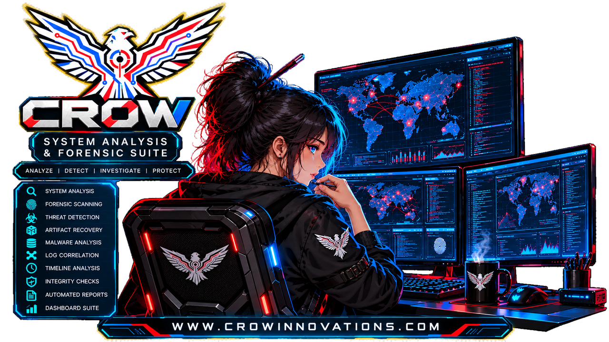
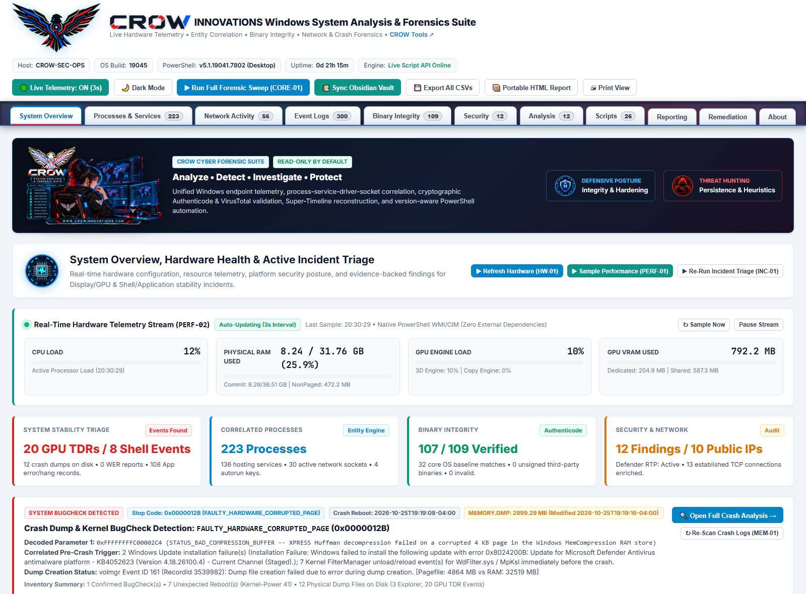

# 🛡️ CROW INNOVATIONS Windows System Analysis & Forensics Suite

**Developed by [CROW INNOVATIONS](https://crowinnovations.com) — Cyber Research in Offensive Warfare | [Community Tools](https://crowinnovations.com/tools.html)**

 

[-ff2a3d?style=for-the-badge)](LICENSE)

---

The **CROW INNOVATIONS Windows System Analysis & Forensics Suite** is a standalone, zero-dependency endpoint forensics, live hardware telemetry, and threat-hunting workstation for Windows 10, Windows 11, and Windows Server. Powered by 26 allowlisted PowerShell modules and an interactive Light/Dark local web console, it correlates processes, services, kernel drivers, registry persistence, network sockets, event logs, binary signatures, and system crash dumps in a 100% read-only forensic posture. It operates completely offline or via a lightweight localhost controller with real-time 3-second CPU, RAM, GPU, and VRAM streaming. Built by **[CROW INNOVATIONS](https://crowinnovations.com)** (*Cyber Research in Offensive Warfare*) to give Threat Hunters, Blue Teams, and Defenders immediate, evidence-backed visibility without external agents or cloud dependencies. **Free for non-commercial use; commercial use is prohibited without prior written approval from CROW INNOVATIONS.**

---

## 🖥️ Interactive Forensic Dashboard

  

---

## 🎯 Capabilities for Threat Hunters & Defenders

- **Creation-Time-Aware Entity Correlation (`CORR-01`, `PROC-01`, `SVC-01`, `DRV-01`):** Maps active processes (`PID`/`PPID`), command-line arguments, SHA-256 hashes, Authenticode signatures, hosted Windows services (`ServiceDll`), kernel drivers (`.sys`), registry autoruns, and active network sockets with prioritized **Threat Assessment** and **Risk Assessment** scoring.
- **Deep Persistence, LotL & ScriptBlock Hunting (`MAL-01`..`MAL-06`, `REG-01`):** Hunts WMI permanent event subscriptions (`root\subscription`), Scheduled Tasks, BITS transfer queues, PowerShell Event ID 4104 ScriptBlock obfuscation, AMSI/ETW/process-hollowing indicators, `Winlogon` `Shell`/`Userinit`, IFEO `Debugger` hijacks, and unsigned Explorer shell extensions.
- **Cryptographic Binary Integrity & VirusTotal Triage (`INT-01`..`INT-03`):** Verifies `System32` and active process binaries against Microsoft Authenticode and Windows Catalog (`WinVerifyTrust`) signatures, diffs against trusted local SHA-256 baselines, and provides one-click **VirusTotal & Hybrid-Analysis (`🛡️ VT`)** inspection.
- **Network Socket Forensics & External IP Intelligence (`NET-01`, `NET-02`):** Correlates listening ports and established TCP/UDP sockets to owning processes and services with automated RDAP/WHOIS ASN, Organization, Country, Reverse DNS, AbuseIPDB, and Shodan enrichment.
- **Unified Chronological Super-Timeline & Event Log Clustering (`EVT-01`, `UTIL-04`):** Clusters high-signal events across `Security`, `System`, `Application`, `Defender`, `PowerShell/Operational`, and `Sysmon` into a unified 500-event chronological Super-Timeline merging process creation, socket activity, scheduled task runs, and crash artifacts.
- **Kernel BugCheck & Memory Dump Forensics (`MEM-01`, `MEM-02`, `INC-01`):** Decodes `Kernel-Power` Event 41 BugCheck Stop Codes and 64-bit Parameters 1–4, correlates 30-minute pre-crash driver/update/thermal activity, inventories `MEMORY.DMP`, `Minidump`, and `LiveKernelReports` (GPU TDR `WATCHDOG` 141), and captures on-demand process minidumps (`dbghelp.dll`) with SHA-256 chain-of-custody logging.
- **Real-Time 3s Hardware Telemetry & Portable Evidence Packaging (`PERF-02`, `UTIL-01`, `UTIL-05`, `REM-01`):** Streams live CPU, RAM, GPU, and VRAM telemetry every 3 seconds, synchronizes cross-linked Markdown investigation notes, exports SHA-256 tamper-evident single-file HTML executive reports and CSV/Excel suites, and enforces dry-run-first remediation.

---

## 📜 License & Commercial Use Policy

Released under the **[CROW INNOVATIONS Non-Commercial License](LICENSE)**.  
This software is provided **free of charge** for personal, educational, research, and internal defensive/threat-hunting use. **Commercial use, resale, paid consulting distribution, or integration into commercial products/services is strictly prohibited without prior written approval from [CROW INNOVATIONS](https://crowinnovations.com).**
